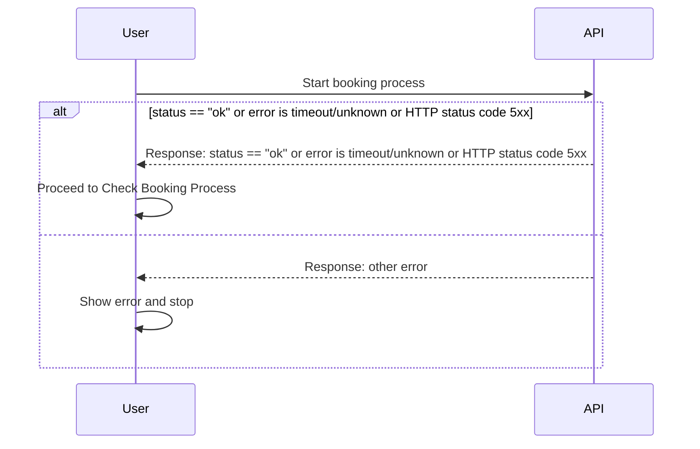

# Start booking process



```
https://api.ratehawk.com/api/b2b/v3/hotel/order/booking/finish/
```


```
https://api-sandbox.ratehawk.com/api/b2b/v3/hotel/order/booking/finish/
```




* <strong>This call is required</strong>.
* Request this call right after the [Create booking process] call.
* As the booking process is made asynchronously, repeatedly request the [Check booking process] call to know the status.


The call starts the booking process.


If invalid user data is used, the data may be added to the stop list.


## Sandbox limitations { #limitations }

{}

* The possible values for the `payment_type.type` field are `hotel` and `deposit`.
* The following fields are not supported: `payment_type.init_uuid`, `payment_type.pay_uuid`, `upsell_data`, and `return_path`.
* For all objects with the `currency_code` field the value is always `EUR`.
* The following errors are not supported: `book_hash_not_found`, `rate_not_found`, `return_path_required`, `not_enough_credit_card_data`, `incorrect_init_uuid_format`, and `incorrect_pay_uuid_format`.


{}

## Request body

[//]: # (arrival_datetime)

{}


[//]: # (language)

{}


[//]: # (partner)

{}


{}



{}



{}



[//]: # (payment_type)

{}


{}



{}



{}



{}



{}



[//]: # (upsell_data)

{}


{}


{}



{}




{}



{}



{}



[//]: # (return_path)

{}


[//]: # (rooms)

{}


{}


{}



{}



{}



{}



{}




[//]: # (user)

{}


{}



{}



{}



[//]: # (supplier_data)

{}


{}



{}



{}



{}



{}
{}

## Request example



```shell
curl --user '<KEY_ID>:<API_KEY>' 'https://api.ratehawk.com/api/b2b/v3/hotel/order/booking/finish/' \
--header 'Content-Type: application/json' \
--data '{
  "language": "en",
  "arrival_datetime": "2027-06-14T14:30:00",
  "partner": {
    "partner_order_id": "9f1c2b7e-4a3d-4c8e-b1f2-6d7a8e9c0b13",
    "comment": "Corporate client, invoice to HQ.",
    "amount_sell_b2b2c": "520.00"
  },
  "payment_type": {
    "type": "deposit",,
    "amount": "412.50",
    "currency_code": "EUR"
  },
  "return_path": "https://example.com/booking/return?order=9f1c2b7e",
  "rooms": [
    {
      "guests": [
        {
          "first_name": "Martin",
          "last_name": "Smith",
          "gender": "male"
        },
        {
          "first_name": "Emma",
          "last_name": "Smith",
          "gender": "female"
        },
        {
          "first_name": "Eliot",
          "last_name": "Smith",
          "is_child": true,
          "age": 11,
          "gender": "male"
        }
      ]
    }
  ],
  "upsell_data": [],
  "user": {
    "email": "john.smith@example.com",
    "phone": "12124567899",
    "comment": "Non-smoking room, high floor if possible."
  },
  "supplier_data": {
    "first_name_original": "Peter",
    "last_name_original": "Collins",
    "email": "peter.collins@example.com",
    "phone": "12124567880"
  }
}'
```


```shell
curl --user '<KEY_ID>:<API_KEY>' 'https://api-sandbox.ratehawk.com/api/b2b/v3/hotel/order/booking/finish/' \
--header 'Content-Type: application/json' \
--data '{
  "language": "en",
  "arrival_datetime": "2027-06-14T14:30:00",
  "partner": {
    "partner_order_id": "9f1c2b7e-4a3d-4c8e-b1f2-6d7a8e9c0b13",
    "comment": "Corporate client, invoice to HQ.",
    "amount_sell_b2b2c": "520.00"
  },
  "payment_type": {
    "type": "deposit",,
    "amount": "412.50",
    "currency_code": "EUR"
  },
  "return_path": "https://example.com/booking/return?order=9f1c2b7e",
  "rooms": [
    {
      "guests": [
        {
          "first_name": "Martin",
          "last_name": "Smith",
          "gender": "male"
        },
        {
          "first_name": "Emma",
          "last_name": "Smith",
          "gender": "female"
        },
        {
          "first_name": "Eliot",
          "last_name": "Smith",
          "is_child": true,
          "age": 11,
          "gender": "male"
        }
      ]
    }
  ],
  "upsell_data": [],
  "user": {
    "email": "john.smith@example.com",
    "phone": "12124567899",
    "comment": "Non-smoking room, high floor if possible."
  },
  "supplier_data": {
    "first_name_original": "Peter",
    "last_name_original": "Collins",
    "email": "peter.collins@example.com",
    "phone": "12124567880"
  }
}'
```



{}



{}

## Response


Returns null.



{}



{}



{}


{}
{}

## Response example

```json
{
  "data": null,
  "debug": {
    "api_endpoint": {
      "endpoint": "api/b2b/v3/hotel/order/booking/finish",
      "is_active": true,
      "is_limited": true,
      "remaining": 29,
      "requests_number": 30,
      "reset": "2027-03-10T12:25:00",
      "seconds_number": 60
    },
    "request": {
      "language": "en",
      "arrival_datetime": "2027-06-14T14:30:00",
      "partner": {
        "partner_order_id": "9f1c2b7e-4a3d-4c8e-b1f2-6d7a8e9c0b13",
        "comment": "Corporate client, invoice to HQ.",
        "amount_sell_b2b2c": "520.00"
      },
      "payment_type": {
        "type": "now",
        "amount": "412.50",
        "currency_code": "EUR",
        "init_uuid": "c44ef1ba-595b-437f-ad14-74ce39a0f9ad",
        "pay_uuid": "797870e3-e1f0-470a-87b3-38694f58bed1"
      },
      "return_path": "https://example.com/booking/return?order=9f1c2b7e",
      "rooms": [
        {
          "guests": [
            {
              "first_name": "Martin", 
              "last_name": "Smith", 
              "gender": "male"
            },
            {
              "first_name": "Emma", 
              "last_name": "Smith", 
              "gender": "female"
            },
            {
              "first_name": "Eliot", 
              "last_name": "Smith", 
              "is_child": true, 
              "age": 11, 
              "gender": "male"
            }
          ]
        }
      ],
      "upsell_data": [],
      "user": {
        "email": "john.smith@example.com",
        "phone": "12124567899",
        "comment": "Non-smoking room, high floor if possible."
      },
      "supplier_data": {
        "first_name_original": "Peter",
        "last_name_original": "Collins",
        "email": "peter.collins@example.com",
        "phone": "12124567880"
      }
    },
    "method": "POST",
    "real_ip": "104.30.161.77",
    "request_id": "9825cb9520644dce46912a48162fb743",
    "key_id": 1234,
    "api_key_id": 1234,
    "utcnow": "2027-03-10T12:24:05.091214"
  },
  "status": "ok",
  "error": null
}
```

{}


## Errors

The `error` field has the value specified in the headers below.

### `book_hash_not_found`

A rare internal error when the ETG couldn’t recognize the `book_hash` used in the booking.

After getting the error, the only option is to find another rate and continue with it.

### `booking_form_expired`

In case [Create booking process] has been expired.

Request a new [Create booking process] with a different `partner_order_id`.

### `chosen_payment_type_was_not_available_on_booking_form`

The `payment_type` field values don’t match any of the `payment_types` field values in the response of the [Create booking process] call.

Try to change the `payment_type` field value according to the `payment_types` field values in the response.

### `credit_card_required`

A credit card is required to complete the booking.

### `double_booking_finish`

An attempt to finish the booking for the second time while the status of the first attempt isn’t an error.

### `email`

The provided email address isn’t valid.

### `incorrect_chosen_payment_type`

Invalid data provided in the `payment_type` field of the call request. The supplied `type`, `amount`, and/or `currency_code` values do not match any of the `payment_type` options received from the [Create booking process] call.

### `incorrect_guests_number`

The adult guest number doesn’t match the adult guest number in the request of the [Retrieve hotelpage] call.

Try to change the `rooms` field item number according to the `guests` field values in the request.

The total number of adults derived from rooms[].guests[] does not match the search query. Any guest without `is_child` = `true` is treated as an adult (the `age` field alone does not mark a guest as a child).

### `incorrect_children_data`

* The children guest number doesn’t match the children guest number in the request of the [Retrieve hotelpage] call.
* The children age is incorrect.

Try to change:
* The `rooms` field item number according to the `guests` field values in the request.
* The `age` field value.

### `incorrect_rooms_number`

The room number doesn’t match the room number in the request of the [Retrieve hotelpage] call.

Try to change the `rooms` field item number according to the `guests` field values in the request.

### `insufficient_b2b_balance`

In case the credit limit is not sufficient for the reservation.
To discuss changes to this limit please contact your account manager.

### `order_not_found`

The order with the `partner_order_id` field value isn’t found.

Send another booking creation request and change the `partner_order_id` field value.

### `rate_not_found`

The rate isn’t found. Send another search request.

### `return_path_required`

The `return_path` field is required if the rate you are booking has the `payment_types` field with the `now` value.

### `unauthorized_group_booking`

An attempt to make a request with the conditions:
* More than 9 bookings in the same hotel.
* More than 9 bookings for the same dates.
* In one request.

To make a group booking:
* Contact the API support team.
* Fill in the group booking form on the site.

### `invalid_upsell_attributes`

Invalid name and attributes combination in `upsell_data` field.

### `invalid_upsell_uid`

Invalid upsell uid in `upsell_data` field.

### `invalid_upsell_data`

Only early check-in and late check-out can be specified in the `upsell_data`, with a maximum of two values allowed.

### `arrival_date_differs_from_checkin_date`

The check-in date should be equal to or the day after the check-in date in the request of the [Retrieve hotelpage] call.

Try to change the `checkin_datetime` field value according to the `checkin` field value in the request.

### `not_enough_credit_card_data`

The `init_uuid` and `pay_uuid` fields are required if the rate you are booking has the `is_need_credit_card_data` field with the `true` value.

### `incorrect_init_uuid_format`

The `init_uuid` field values don’t match the regular expression.

### `incorrect_pay_uuid_format`

The `pay_uuid` field values don’t match the regular expression.

### `card_type_not_supported`

The selected card type is not supported for this booking.   
Try using a different card.

### `sandbox_restriction`

An attempt to book the test hotel with the `hid` = `8473727` in the [production environment].

To book the test hotel, use the [test environment].

### `supplier_data_required`

The `supplier_data` field is required for your integration. Contact your account manager.

### `no_pricing_data`

* The contract is not activated in the system.
* Network delay or connection error.

Verify that the contract is active and retry the request. If the issue persists, contact your account manager.

### `timeout`, `unknown`, and `5xx`

If you get the error, it doesn’t necessarily mean the booking isn’t created. These errors may occur because of the ETG services’ timeout. To check the booking creation, send the [Check booking process] request.

## Error Handling Diagram

Below is a sequence diagram describing how to handle errors during the start booking process:


